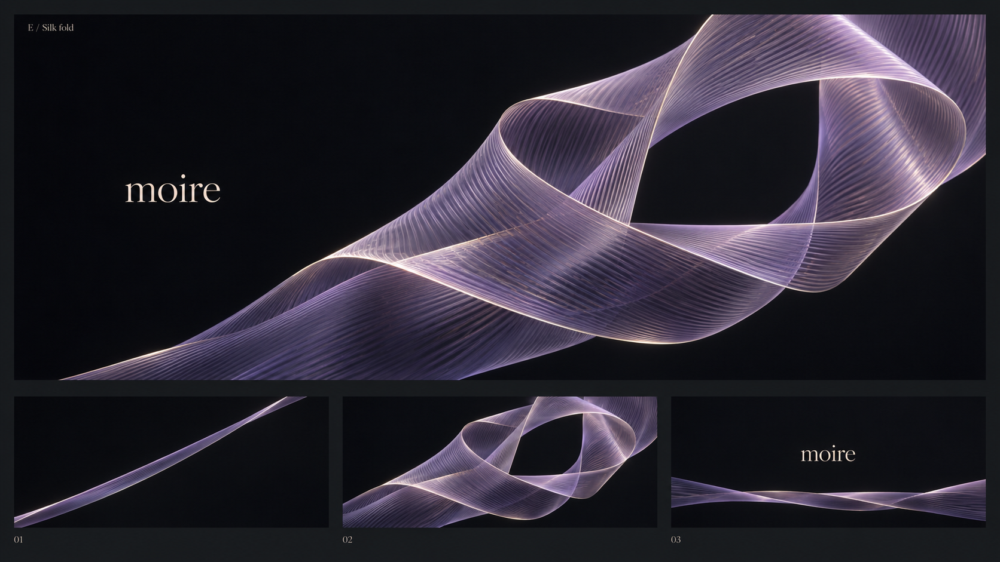

# Moire handoff, 2026-10-06

## Latest UTM graphics follow-through

Josh requested the latest UTM image, VirGL and visible greeter motion after
the earlier stopping scope. R10 now shows clear wave movement in actual UTM,
with Reduce motion off. The sole active guest is **Moire C63 R10 VirGL**
(`C84589D6-9DDD-43A3-A3CB-3FBDEF53132A`), left at a fresh greeter for Josh.
Input capture is released. The exclusive VM reservation remains held for user
inspection; coordinate with Recovery before stopping it or starting a builder.

UTM was updated from official stable 4.5.3 (99) to 4.7.5 (118), with signature
and notarization checks. The old app is preserved in `vm/tools/UTM-4.5.3.app`.
The update fixed the pre-Linux VirGL stall. R10 fixes virtual SHM output
observations, bounded greeter motion admission, elapsed frame timing and the
visible 16/22-second wave profile. Ordinary Backdrop consumers stay ambient.
No PAM, AccountsService, security permissions or seat access changes were made.

Native VirGL, visible movement, local Reduce motion stop/resume, wrong/blank
real PAM denial and one correct desktop/logout/fresh-greeter cycle passed.
Desktop 3293 released devices and session-3.scope retired; fresh greeter 3415
is active on seat0. Rapid automated text input lost characters; individual
keys succeeded. That input issue remains undiagnosed. R10 normal shutdown is
untested, and physical tearing/performance are unqualified.

See [R10 build/run commands, evidence and limits](docs/native-utm-virgl.md).
R10 SHA256 is `72cc0a59cea7ec860f46efaeb1cf853d3c38790a686861f7ae6996da336740a1`.
R8/R9 are preserved intermediate images; R9's drift was too subtle and is not
accepted as visible animation. R9 cleanup required an explicit forced stop
after its normal shutdown request failed. Accepted R6 and all older fallbacks
remain preserved. The historical R6 acceptance below has not been revoked.

## Historical R6 handoff, 2026-10-05

## Stopping scope and current state

Josh's latest stopping scope is the greeter, followed by another agent. Finish
reviewed greeter work only. Animated boot splash is owed follow-through in the
next agent's list; do not implement boot or unrelated desktop features now.

The greeter is finished within the recorded scope. The final immutable C63 R6
image adopts Josh's accepted centred design and passed native AccountsService,
real PAM denial/cancel/retry, two desktop/login/logout/fresh-picker cycles and
Reduce motion tests. R5 and all earlier images remain preserved.

Builder and candidate shut down normally with QEMU exit 0. Every display owner
released devices completely, no QEMU remains, and Recovery was notified that
the exclusive VM lease is released. No greeter build or test is pending. Stop
after delivering this handoff; the next agent owns unfinished boot work.

Repository: `~/projects/moire`. This checkout contains hundreds
of earlier changes and untracked files. Inspect scoped diffs; do not reset,
commit everything, delete fallbacks or clean unrelated work. One owner finished
this greeter work; no new agents were created.

## Reproduce the accepted image

From the repository root, coordinate an exclusive VM window with Recovery before
starting any builder or candidate. Choose a fresh filename when building:

```sh
python3 scripts/build-native-login-probe.py --desktop --output moire-aarch64-native-desktop-next.iso
scripts/run-native-login-probe.sh vm/nixos/moire-aarch64-native-desktop-next.iso
```

Boot the tested snapshot:

```sh
scripts/run-native-login-probe.sh vm/nixos/moire-aarch64-native-desktop-c63-r6.iso
```

| Image | Bytes | SHA256 |
| --- | ---: | --- |
| C63 R6, final centred greeter | 992876544 | `ddf3ab6306b353020dfd7281f3f040784a5537eaae489fb7431879681b337902` |
| C63 R5, preserved PAM retry checkpoint | 991074304 | `4221ddbd4fdbe35f478c05c1dae587ea95184b8bf6e9e4bb37fd21f9acae0cd4` |
| C63 R4, preserved user-picker checkpoint | 991037440 | `b7a123d5391f11fdabfd70456a4b7325d32155afe900562230a855e728295ae0` |

All three are mode 0400. All 67 earlier ISO metadata records match the pre-build snapshot. R3/R2/R7 and all earlier images remain preserved. Their
history and exact receipts are linked in [native desktop evidence](docs/native-desktop-vm.md)
and [the native PAM probe](docs/native-login-probe-vm.md). Never rebuild over an
accepted filename. Image build receipts retain their initial pending acceptance;
separate `candidate-acceptance.json` records contain native observations.

The public disposable account is `moire-pam-test`, password
`moire-pam-test-only-20261004`. Click the account, enter its password, then submit.
This is a test fixture, not a personal credential. The desktop initially opens
Files. Quick settings → Power → Log out returns to a fresh greeter.

The build uses pinned Nix dependencies in a dedicated ARM64 Linux builder on
Apple Silicon. Host Nix is not required. QEMU/HVF, virtio GPU/keyboard/tablet,
logind and real greetd/PAM are the tested runtime. Candidates have no network,
shares or writable data disk; changes live in RAM over the read-only base ISO.
UTM GUI import/boot has not been qualified for this checkpoint. Ancient Parallels
images do not represent the current sources. Do not switch to Cage, Ubuntu or
host services to conceal a native failure.

## Verified greeter behavior and source changes

R6 evidence: [native acceptance](vm/verification/native-desktop-20261005T081531Z/candidate-acceptance.json),
[screenshots/logs](vm/verification/native-desktop-20261005T081531Z/) and
[rerunnable verifier](vm/verification/native-desktop-20261005T081531Z/verify-acceptance.py).
R5 evidence: [native acceptance](vm/verification/native-desktop-20261005T074513Z/candidate-acceptance.json).
R4 evidence: [native-desktop-20261005T070814Z](vm/verification/native-desktop-20261005T070814Z/).

R6 ran AccountsService 23.13.9 and discovered the public local account. The
provider reads bounded public metadata only. It filters locked/system/root and
non-local or non-login accounts, pins the service owner, and rechecks account
eligibility before entering PAM. It reads no password hint, avatar, home or
preferences and performs no AccountsService mutation. PAM remains the authority.

Wrong and blank passwords each produced real PAM `AUTH_ERR`. The same greeter
PID 769 remained alive and showed "Authentication did not complete. Try again."
No desktop launched on denial. A correct retry then reached native desktop
PID 3284/session 3; a second login reached PID 5892/session 7. Both were UID
1000, Class=user, Active=yes, Seat=seat0. Both logouts released devices completely,
retired their PAM scopes and returned to fresh moving user pickers. A confirmed
masked draft cleared on Change user after acknowledged cancellation.

Moving backdrop pixels passed on picker/password/fresh post-logout pickers.
Reduce motion held the full frame unchanged for 14.244 seconds and resumed when
disabled. All greeter and desktop owners retired. Normal ACPI shutdown used an
extra PAM handoff after greeter 6003 released; that is not a third accepted cycle.
The actual settled Files/shell proof is `desktop-cycle1.png` and
`desktop-cycle2.png`; both logout target screenshots show Log out focused.
Keyboard Enter on the focused account reached the password field before the
extra shutdown handoff. `password-initial.png` captures the eligibility check;
use `password-ready.png` for the settled password form.

R4's wrong password safely restarted the greeter instead of inline retry. R5
fixes that narrow transport path: following explicit auth denial, if the first
cancellation returns a generic error, retry cancel once. Require a success
acknowledgement before publishing ready. A second error, timeout or unknown
connection outcome remains terminal. Upstream greetd removes its configuring
slot before cancelling a possibly exited worker; this explains the ordering,
although the downloaded master reference is not an exact installed-revision
qualification. The actual before/after native behavior is recorded.

Relevant source ownership:

- `apps/system/compositor/src/local-users.ts`: read-only account metadata boundary.
- `apps/system/compositor/src/pre-login.ts`: build-time discovery opt-in and D-Bus retirement.
- `apps/system/greeter/src/native/user-selection.ts`: catalogue epochs, selection recheck and cancellation flow.
- `apps/system/greeter/src/native/view.tsx`, `main.tsx`: production picker/password presentation and Window motion policy.
- `apps/system/greeter/src/native/controller.ts`: immutable attempt/prompt ownership, acknowledged ready transitions, fixed launch.
- `apps/system/display-manager/src/native-greetd-client.ts`: bounded denial cancellation retry.
- `nix/moire-native-desktop-image.nix`: approved isolated AccountsService activation and R6 provenance.
- `nix/moire-native-login.nix`: installed Linux checks and literal session/discovery entry.
- `scripts/qemu-pointer-probe.py`: host diagnostic only; one-pixel motion nudge ensures replacement compositors receive fresh absolute axes.

Focused IPC regressions failed before repair and passed after it. Host checks
passed 30 IPC cases, 11 controller cases, 11 entry cases and targeted typecheck,
lint/format. Installed Linux Node 22 passed the 30 IPC cases, five actual Window
picker cases, six private D-Bus provider cases and existing wave/input/retirement
checks. Fixture PAM and account metadata are synthetic; native acceptance rests
on the actual candidate screenshots and logs. Re-run source checks with:

```sh
bash scripts/test-native-greeter.sh
bash scripts/check-native-user-picker.sh
```

R6 product sources match the build snapshot. Later changes are acceptance and
handoff documentation only, pinned in `post-build-changes.json`. The build
receipt and guest provenance retain initial pending/false acceptance; the
separate candidate record reports observed native acceptance.

## Accepted visual design adopted in R6

Josh accepted these exact centred captures via Loop/Bridge:

| Reference | SHA256 | Library ID |
| --- | --- | --- |
| [Picker](vm/verification/greeter-design-centered-20261005T080100Z/picker-avatar.png) | `a212120aecf80e74acb09194c60b809062ee154f1cbc9b7f10b1a3b88f0f1f1c` | `libfile_20f3503338b88191be08b172e210478c` |
| [Password/flyout](vm/verification/greeter-design-centered-20261005T080100Z/password-desktop-flyout.png) | `d724d026977c7f09b785cc6f86e137459c893de189cd59a1a09bb3db41a03798` | `libfile_8aca0376cb5881919bb28bc821b15c1c` |

`apps/system/greeter/src/native/design-mocks.tsx` renders those references with
shared widgets, a Silk still and synthetic identities. Production uses bounded
public initials, circular account focus, centred compact authentication,
full-width Sign in, quiet Change user and a transparent desktop trigger.
The native flyout is undimmed and contains only the fixed installed Moire Wayland
session. The mock's illustrative alternative does not exist in production.
No home/avatar read or arbitrary session command was added. The legacy username
probe keeps its previous flow.

Actual R6 [picker](vm/verification/native-desktop-20261005T081531Z/picker-live.png),
[password](vm/verification/native-desktop-20261005T081531Z/password-ready.png) and
[flyout](vm/verification/native-desktop-20261005T081531Z/password-desktop-flyout.png)
were visually reviewed. Earlier five-image proposals, black/incomplete fixtures
and superseded centred captures are not approved/current. Bridge handles Library
delivery and routing into Loop's private room; local inspection alone is not
an attachment claim.

## Boot splash is unfinished, with the original sample



This is the original selected **Silk Fold E v0 static design reference**. It is
not an animation or native boot screenshot. SHA256
`000d23e4d59beec91739cf6bd1ab4f766c040db451e91b56ce84f898eb3944bf`.
The portable copy has matching bytes and a provenance sidecar. Original path:
`~/Documents/Codex/2026-10-02/task-3/approved-design-references/Moire E - Silk fold.png`.
Original Library ID `libfile_2a6b578cd7bc8191919fdf57af572d9b`, version 0.
The inspection record is
`vm/verification/2026-10-02-app-suite-candidate-8/inspected-design-references.json`.

Preserve existing `apps/system/boot` sources and handoff scripts. A future agent
must inspect them, integrate the smallest boot animation into a fresh native
NixOS candidate, then verify actual boot → splash → complete device release →
greeter ownership. A moving greeter wave does not complete boot animation.
Review any material new service/security activation before running it. No boot
implementation is authorized in this stopping phase.

## Remaining daily-driver work for the next agent

[Roadmap](docs/roadmap.md) and [daily-use plan](docs/daily-use-plan.md) contain the
broader staged backlog. Earlier app fixture/source claims do not prove those apps
work natively in this R6 image.

- Animated boot splash and verified boot-to-greeter device handoff.
- Secure lock/re-authentication, suspend/resume, power actions and session recovery.
- Hardware rendering, physical tearing/frame pacing, multi-output and real hardware input. R6 uses software EGL llvmpipe LLVM 21.1.8/Mesa 26.1.8; no acceleration or tear-free claim.
- Native end-to-end app workflows, file associations, media/documents and portals. [Notifications service/history](docs/desktop-services.md) already exists; image/markup/sound/persisted-history support is absent. [C50 optional removable image](docs/removable-drives.md) already has native mount/open/unmount/USB PowerOff proof, while optical Eject is unqualified. UDisks/Polkit remain disabled in this greeter image. R3 Files sidebar/folder/Alt+Up proof is preserved separately; R6 did not repeat full app workflows.
- Pointer drag/scroll, clipboard, IME and accessibility workflows; greeter Reduce motion is application-local, not pre-auth home preference discovery.
- Wi-Fi, Bluetooth, audio, brightness and battery service/hardware integration.
- Installation, upgrades, sudden-loss durability, disposable overlays and QMP lifecycle tooling beyond private test diagnostics. [C44](docs/daily-use-plan.md) already has optional ext4 persistence for home and `/etc/moire`, with clean cold-boot exact readback; this native greeter image does not attach that disk.
- Hand-editable `/etc` configuration is Josh's preference. Preserve it in future configuration work, but this read-only test ISO currently keeps edits in RAM. Use the documented optional C44 persistence path when its scope is deliberately selected. Account preference access and runtime session overrides still require defined trust boundaries.

No paid services, credentials or new system permissions should be added without
asking. Existing AccountsService approval covers this isolated guest daemon,
not additional groups, ACLs, Polkit grants, root renderer access, host services or
personal disks. Coordinate all VM work and preserve fallbacks before testing.
