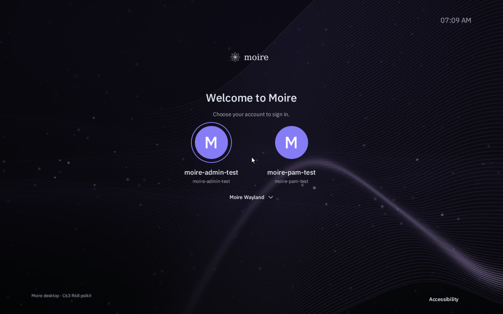
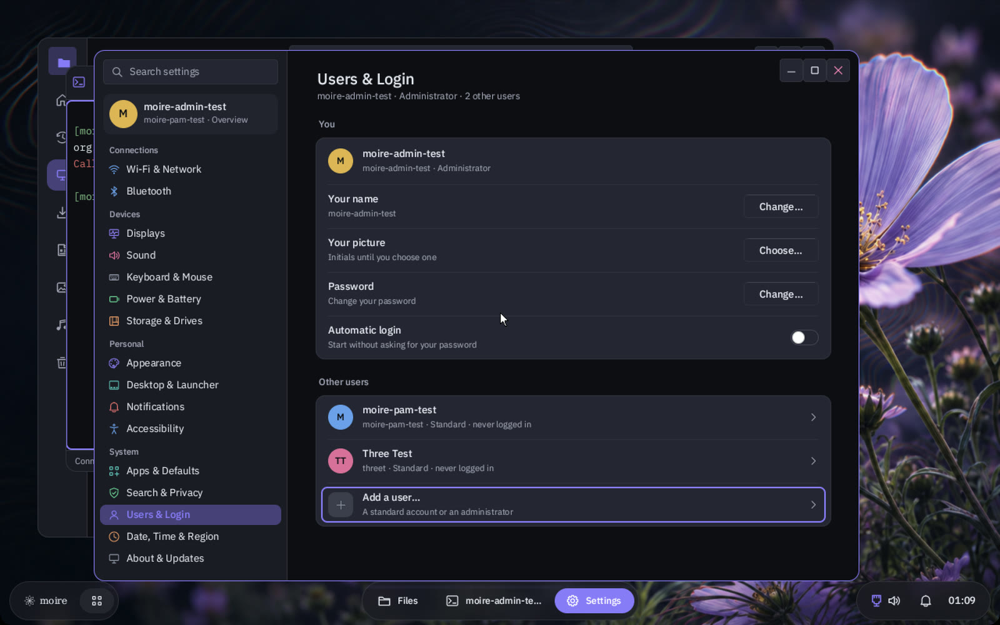
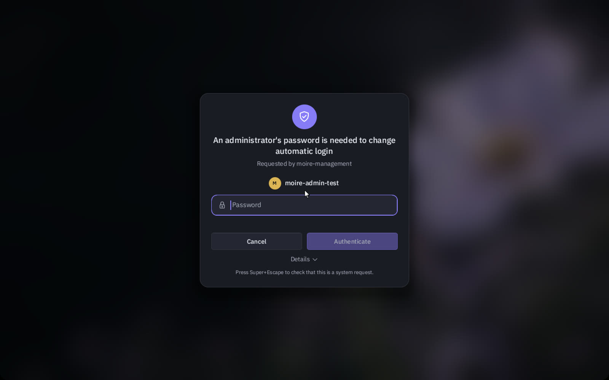

# Moire

A TypeScript **compositing Wayland desktop environment** — DRM/KMS-first, always-on scene compositing, React/Yoga shell (SSD, launcher, panel), Freedesktop app discovery, and XWayland for broad app support.

> Day-0 bar: session D-Bus, Moire Files, native Terminal, LibreOffice, overlapping composited windows with React decorations.

## Screenshots



| | |
|---|---|
|  |  |
| Settings: Users & Login | Moire's polkit prompt asking for an administrator's password |

More in [docs/screenshots.md](docs/screenshots.md). All were captured from the ARM64 VM.

## Documentation

Full docs tree (roadmap, architecture, widget catalog, shell/apps, DnD, prefs): **[docs/README.md](docs/README.md)**.

Application authority and placement boundaries: **[apps/README.md](apps/README.md)**.

Sidebar / SUMMARY for MD renderers: [docs/SUMMARY.md](docs/SUMMARY.md).

The [app suite](docs/apps/suite.md) documents supported workflows, backend requirements and unfinished acceptance checks.

## Monorepo

```
apps/
  core/            # OS management UI: Settings, processes, recovery
  system/          # compositor, session and broker services
  bundled/         # Files, Terminal and the first-party app suite
  developer/       # Showcase and renderer diagnostics
packages/
  dbus/           # pure-TypeScript session D-Bus wire/client/server
  protocol/       # Wayland wire codec
  core/           # surfaces, xdg-shell, DnD, composite
  sys/            # koffi FFI → libdrm, gbm, EGL, libinput, libc
  theme/          # design tokens + wallpaper
  prefs/          # settings.json + apply
  react-host/     # react-reconciler → CPU scene graph + TTF
  ui/             # @moire/ui app SDK + widgets
  terminal/       # VT screen model + Linux PTY transport
  shell/          # SSD, launcher, panel, desktop icons
  app-discovery/  # Freedesktop .desktop + MIME/file activation
  system-management/ # typed core-app service client and contracts
themes/           # bundled theme.json + GTK Moire theme
docs/             # full documentation tree (start at docs/README.md)
```

## Requirements

- **Linux** with DRM (`/dev/dri`) and input devices for real runs. On Apple Silicon,
  use the NixOS QEMU/HVF workflow below.
- Node.js **≥ 22**, pnpm **9**
- System libs: see [docs/dev-vm.md](docs/dev-vm.md)

## Reproducible ARM64 VM

The current Apple Silicon image uses a dedicated NixOS builder and Moire's native
greeter. The C63 R6 image from 2026-10-05 boots the current shell and Files under
HVF, with an AccountsService user picker, password flow, moving software greeter
backdrop and a local Reduce motion control. Two real authenticated
desktop/login/logout/fresh-picker cycles passed. Files navigation has separate
proof on the preserved R3 image. Wider app workflows, graphics performance and tearing remain
unqualified. Old Parallels images do not represent this checkpoint. The greeter
shows `Moire desktop · C63 R6` to identify the current image.

Follow the prerequisites and VM coordination instructions in
[Authenticated native desktop](docs/native-desktop-vm.md). Choose a fresh output
filename, then build and boot that exact image:

```bash
python3 scripts/build-native-login-probe.py --desktop --output moire-aarch64-native-desktop-local.iso
scripts/run-native-login-probe.sh vm/nixos/moire-aarch64-native-desktop-local.iso
```

To boot the tested C63 R6 snapshot from the repository root:

```bash
scripts/run-native-login-probe.sh vm/nixos/moire-aarch64-native-desktop-c63-r6.iso
```

The launcher checks the explicitly selected ISO's build receipt and checksum.
The base ISO is read-only; candidate changes live in RAM. The graphical candidate
is offline, with no host shares or writable data disk. Host Nix is not required.
Preserve earlier images as fallbacks, including the accepted
[native login/PAM probe](docs/native-login-probe-vm.md).

The [user-picker/password greeter](docs/native-user-picker.md) has live account
discovery, correct/incorrect PAM password, cancellation, logout and Reduce motion
evidence. Wrong and blank passwords return to the picker with an inline error in the
same greeter process; a correct retry succeeds. The centred greeter uses initials
and a transparent, single-session flyout. AccountsService is enabled only
in the isolated desktop configuration. The preserved R3 ISO is unchanged.

## Development on an existing Linux machine

```bash
# In your existing Linux checkout:
pnpm install
pnpm probe:drm          # list DRM connectors via koffi
pnpm dev:compositor     # compositor (WIP)
./apps/system/session/moire-session
```

macOS can edit and typecheck; DRM/FFI probes need Linux. Earlier VM experiments
remain documented in [docs/nixos-vm.md](docs/nixos-vm.md) and
[docs/dev-vm.md](docs/dev-vm.md); their images and commands do not establish
acceptance of the current login checkpoint.

## License

MIT (pending)
