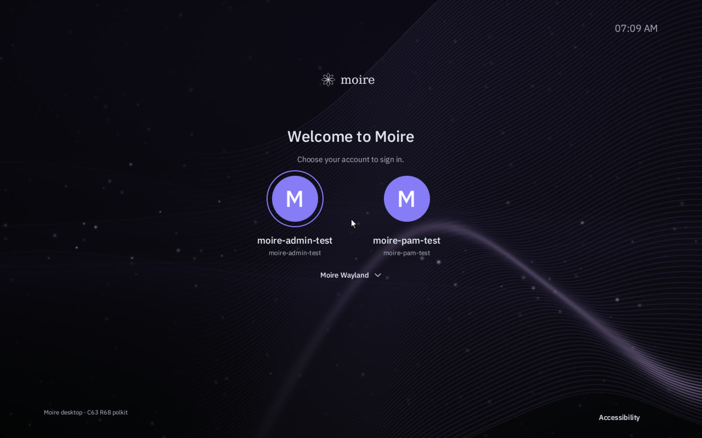
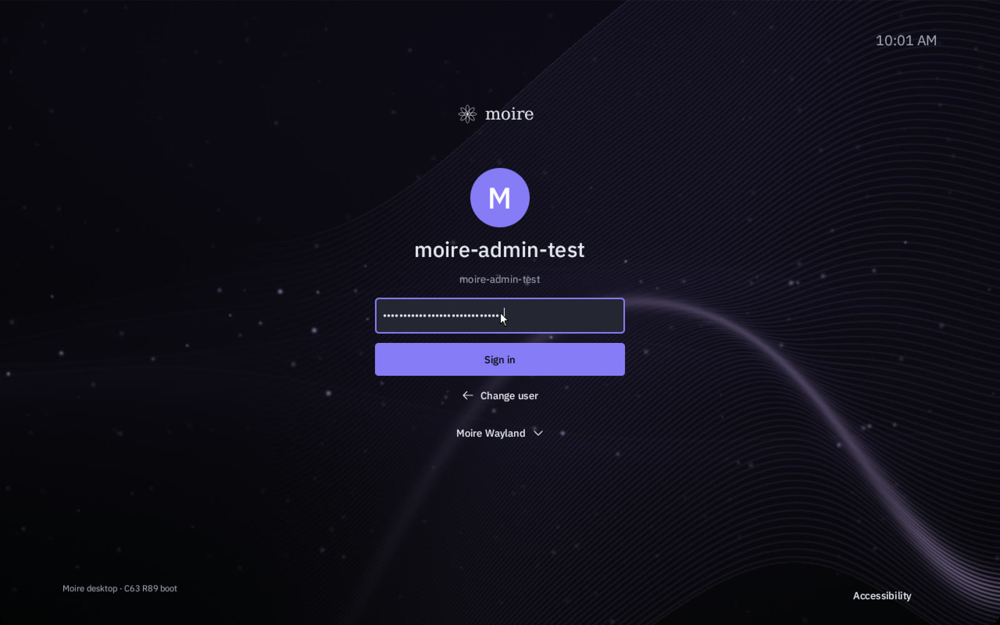
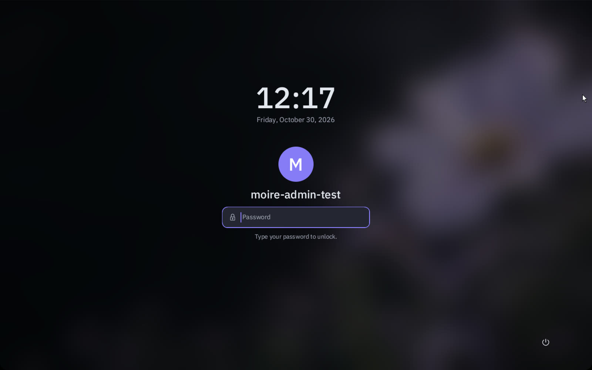
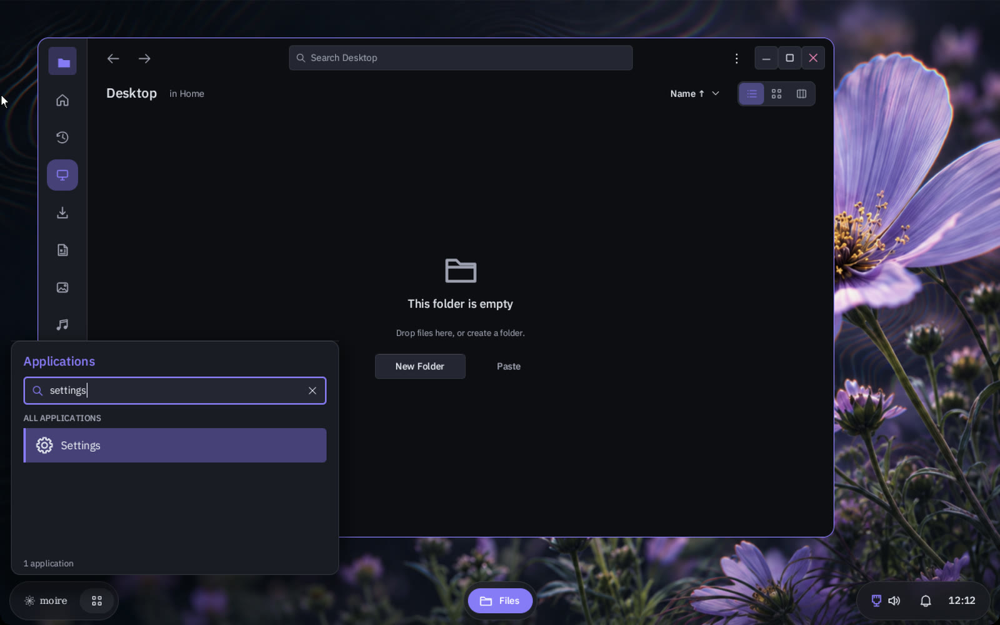
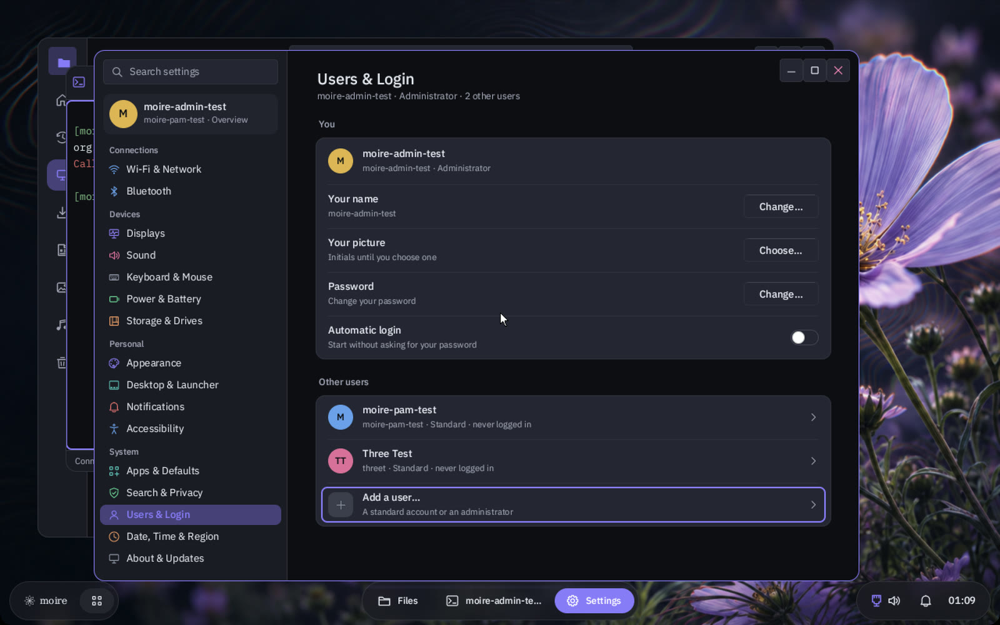
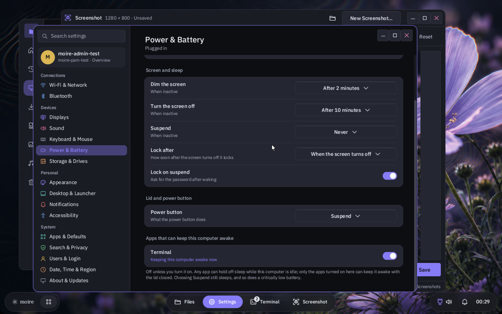
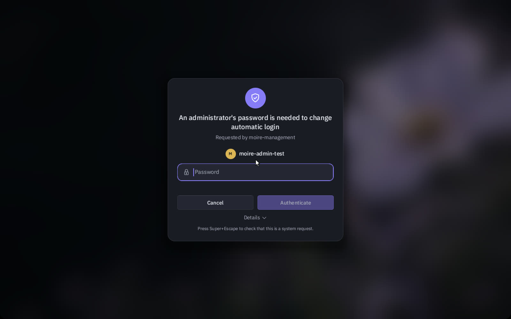
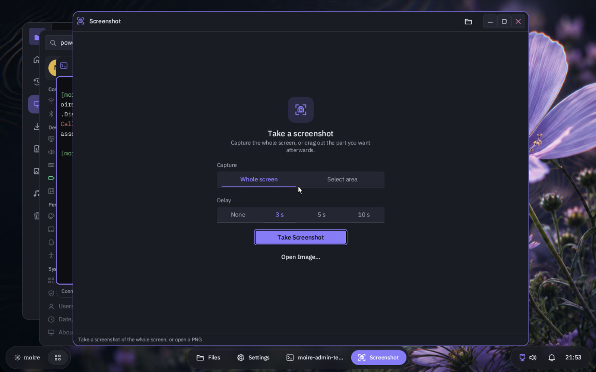

# Screenshots

Captured from the ARM64 VM (UTM with VirGL, 1280×800 at 2×) during the C63 test runs, using the local test accounts.

The greeter's account chooser, drawn over the boot scene it takes over from.

Signing in after choosing an account.

The lock screen over a blurred copy of the desktop.

Searching the launcher, with Files open behind it.

Settings, managing local accounts.

Settings, screen and sleep timings and the apps allowed to keep the computer awake.

Moire's own polkit agent asking for an administrator's password. Super+Escape checks that a prompt really comes from the system.

The Screenshot app.
